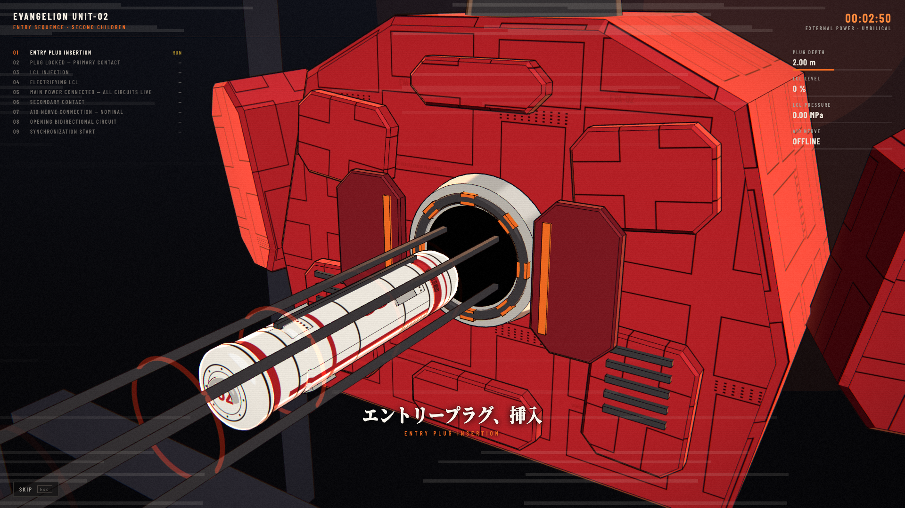
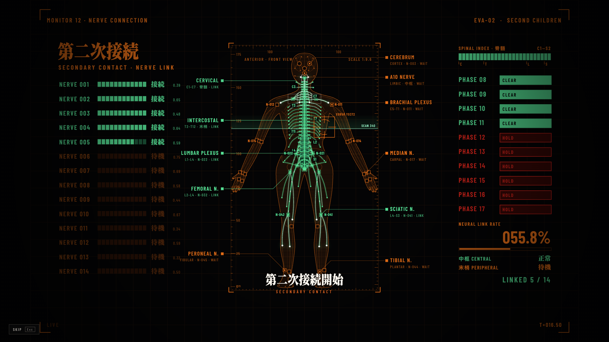
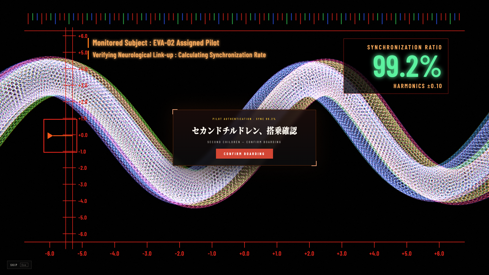

# dsh-theme-eva

An EVA Unit-02 theme for DeepSeek Harness (DSH).

- **Entry cinematic.** Every time the page opens: start gate → cel-shaded (toon + ink outline) entry plug inserted into the spine socket in hard-cut shots → an x-ray scope of the plug sinking through the lock rings → LCL floods the cabin and is electrified → hard cuts to command-room monitor screens (main power distribution, a circuit matrix opening lines 0001–1405, an anatomical nerve-connection schematic lighting up limb by limb, brain-region vital traces for the A10 link, a three-computer vote) between Mincho intertitle cards → a harmonics scope where the pilot and unit waves (hex-mesh tubes) close in as the sync ratio climbs to 99.2% and waits for the pilot to confirm → 100% → 「弐号機 起動」 title card → workbench. Everything is drawn in code (three.js + 2D canvas) and loaded only while it plays. Click **Skip** or press **Esc** at any time.
- **Sync plate.** A small plate in the session header: sync ratio = 100% − context window occupancy, taken from the session's real context pressure. Below 30% it turns orange (精神汚染), below 10% red (シンクロ率低下).
- **Running indicator.** At the conversation tail, an 「内部電源」 clock and faint orange line replace the native “Deep diving / 深度求索中” visuals. The clock reads the current open turn's real start timestamp, so switching sessions or mounting mid-turn does not restart it. Turning off the theme or running indicator restores the native display; its static screen-reader announcement is preserved. There is no duplicate indicator above the composer.
- **Backdrop.** Original monitor-style graphics behind the conversation: a faint 弐 watermark, hex grid, vertical captions, phase list and caution stripes (drawn from the OFL fonts as outlines; no third-party artwork).
- **Everyday skin.** Kept restrained so chat and code stay readable: Unit-02 palette, square corners, a red gradient at the top of the sidebar, a "02" unit mark, and Mincho titles. Messages and code blocks keep DSH's own fonts.

Settings live in **Settings → General → EVA 接入 / EVA Link**: theme, cinematic, voice and sound, running indicator and sync plate can each be turned off, and there is a **Replay** button. The sidebar footer has a **重新接入 / Re-link** button too.

While the theme is on, the appearance is locked to dark (EVA has no light mode). Turning it off restores your own light/dark/system setting.

If the system setting **Reduce motion** is on, the 3D cinematic is replaced by a 2-second static title card, with no gates and no running indicator animation.

## Screenshots

Real 1920×1080 captures of the theme's code-rendered startup cinematic (not workbench screenshots or mockups).

### Entry plug insertion



### Nerve connection monitor



### Synchronization and boarding confirmation



## Install

```sh
git clone https://github.com/nerv-base/dsh-theme-eva.git
cd dsh-theme-eva
npm install
npm run build
```

Then, from a DSH session, ask the agent to install the bundle at the absolute path of this directory (plugin manager `install_bundle`), or install it from the plugin market once it is published. Reload the window after installing.

## Develop

| Command | What it does |
| --- | --- |
| `npm run build` | Bundle `src/` into `lib/client.js` (main) and `lib/client.cinema.js` (lazy cinematic chunk). `-- --dev` skips minification, `-- --watch` rebuilds on change. |
| `npm test` | Run the native-status adapter and mounted React lifecycle regression tests. |
| `npm run fonts` | Re-subset the fonts from the full OTF/TTF sources (`EVA_FONT_SRC`, default `/tmp/evafonts`) to the characters used in `src/`. Run after changing any Japanese copy. |
| `npm run voice` | Render missing announcer clips with edge-tts; `-- --force` re-renders all. Needs `python3 -m pip install --user edge-tts`. |

`scripts/harness/cinema.html` runs the cinematic on its own: serve the repository root with any static server and open `/scripts/harness/cinema.html`.

Unit-specific values (palette, number, pilot callsign, every cinematic line and its spoken reading) live in `src/shared/units.js`. Only Unit-02 ships today; another unit is one more entry there.

Layout:

```
lib/index.js            Host half: preferences (Config) + allowlisted asset route /eva-theme-assets
src/client/             Browser half: theme tokens, skin CSS, settings row, brand seats, sync meter, overlay
src/cinema/             Lazy chunk: three.js scene, HUD, WebAudio sound design, announcer
src/shared/units.js     Per-unit configuration
assets/                 Icon, font subsets, announcer clips
```

## Credits and licenses

Inspired by **eva-codex-workbench** (MIT, © 2026 Iris-change), an EVA Unit-02 styled Codex workbench. This project is a separate implementation for DSH and copies none of its code.

The code is MIT licensed. Bundled fonts are SIL OFL 1.1 subsets of Noto Serif CJK JP and Barlow Condensed; three.js is MIT. **The announcer clips are not covered by the MIT license**: they were rendered with Microsoft's ja-JP-NanamiNeural voice through edge-tts, and Microsoft has not granted an explicit redistribution license for such output. See [NOTICE.md](NOTICE.md) for details and for how to remove or replace them.

## Disclaimer

This is an unofficial fan work. It is not affiliated with, endorsed by, or sponsored by khara, Inc., Studio Gainax, or any other rights holder of *Neon Genesis Evangelion*, nor by DeepSeek. It contains no footage, music, voice recordings, character artwork or logos from the series. "Evangelion" and related names are trademarks of their respective owners.
